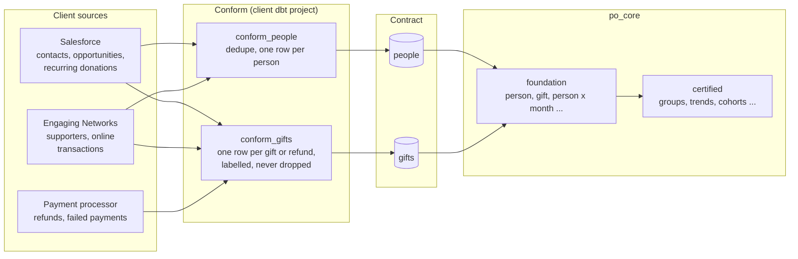
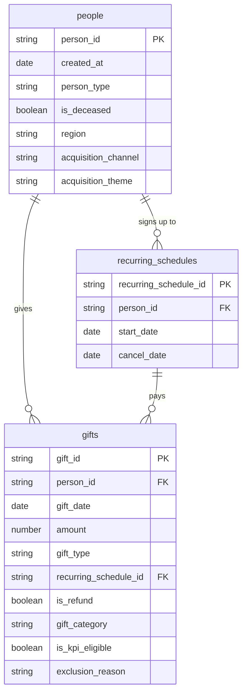

# po_core

A dbt package that turns two standard tables, **people** and **gifts**, into tested donor analytics:
a foundation of facts for analysts, and certified summaries of donor groups (size, giving rates,
what an improvement is worth, whether a test could prove it) for everyone else.

The engine is the same for every organisation. What differs is the **conform**: the client's own dbt
models that reshape their sources into the two contract tables. Everything client-specific lives in
their dbt project: the conform models and the `vars: po_core:` config.



## The contract

### people

One row per person the organisation knows, **with or without gifts**. No names, emails or addresses:
the engine never needs them.

| column | type | required | notes |
|---|---|---|---|
| `person_id` | string | yes | unique; the unit you contact (an individual, or a household) |
| `created_at` | date | yes | when the record was created |
| `person_type` | string | yes | `individual` or `organization` |
| `is_deceased` | boolean | yes | deceased people are left out of groups |
| `region` | string | no | |
| `acquisition_channel` | string | no | how they were first recruited |
| `acquisition_theme` | string | no | the cause or campaign theme that recruited them |

Extra columns (age band, giving capacity, volunteer status ...) can come along as `attr_*`
via `people_extra_columns`.

| person_id | created_at | person_type | is_deceased | region | acquisition_channel | acquisition_theme |
|---|---|---|---|---|---|---|
| P-1001 | 2021-03-14 | individual | false | Ontario | Face to Face | climate |
| P-1002 | 2022-11-02 | individual | false | Quebec | Web | wildlife |
| P-1003 | 2024-06-20 | individual | false | Ontario | Petition | climate |
| P-1004 | 2019-09-01 | organization | false | Alberta | Corporate | |

### gifts

One row per gift **or refund**. Conform labels rows; it never deletes revenue. Gifts that shouldn't
count toward giving behaviour (a capital campaign, event tickets) stay in, with
`is_kpi_eligible = false` and a reason.

| column | type | required | notes |
|---|---|---|---|
| `gift_id` | string | yes | unique |
| `person_id` | string | yes | must exist in `people` |
| `gift_date` | date | yes | refunds dated when refunded |
| `amount` | number | yes | refunds negative |
| `gift_type` | string | yes | `one_time` or `recurring` |
| `recurring_schedule_id` | string | for recurring | the monthly plan the payment belongs to |
| `is_refund` | boolean | yes | |
| `gift_category` | string | yes | `cash`, `pledge_payment`, `matching`, `daf`, `grant`, `bequest`, `in_kind`, `other` |
| `is_kpi_eligible` | boolean | yes | counts toward giving behaviour |
| `exclusion_reason` | string | when not eligible | e.g. `capital_campaign`, `event_fmv` |

| gift_id | person_id | gift_date | amount | gift_type | recurring_schedule_id | is_refund | gift_category | is_kpi_eligible | exclusion_reason |
|---|---|---|---|---|---|---|---|---|---|
| G-501 | P-1001 | 2021-03-14 | 25.00 | recurring | RD-77 | false | cash | true | |
| G-502 | P-1001 | 2021-04-14 | 25.00 | recurring | RD-77 | false | cash | true | |
| G-503 | P-1002 | 2022-11-02 | 100.00 | one_time | | false | cash | true | |
| G-504 | P-1002 | 2022-11-20 | -100.00 | one_time | | true | cash | true | |
| G-505 | P-1004 | 2025-05-01 | 5000.00 | one_time | | false | grant | false | capital_campaign |

### Optional inputs

Each one unlocks more, and nothing breaks without it:

| input | unlocks | status |
|---|---|---|
| `finance_totals` (fiscal year, revenue) | reconciliation against finance | available |
| `people.acquisition_cost` (as an extra column) | cost per new monthly donor, LTV:CPA | available |
| `recurring_schedules` (plan id, person, start, cancel date, cancel reason) | exact monthly-giver status, plan-based lapse and restart | planned: today monthly-giver status is inferred from recurring payments |

The diagram shows where `recurring_schedules` will sit once it's built.



## Using it

```yaml
# packages.yml
packages:
  - git: "https://github.com/chris-purpleotter/po-donor-engine-prototype.git"
    revision: v0.3.4-prototype

# dbt_project.yml
vars:
  po_core:
    people_model: conform_people
    gifts_model: conform_gifts
    as_of: "{{ env_var('PO_AS_OF') }}"      # the month-end to report as of
```

Then `dbt deps` and `dbt build`. Details: `SPEC.md` (the contract and decisions) and
`DESIGN_v0.2.0.md` (foundation, certified, segments, the Planning Pack export).
